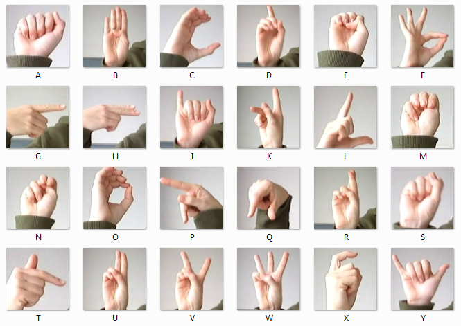
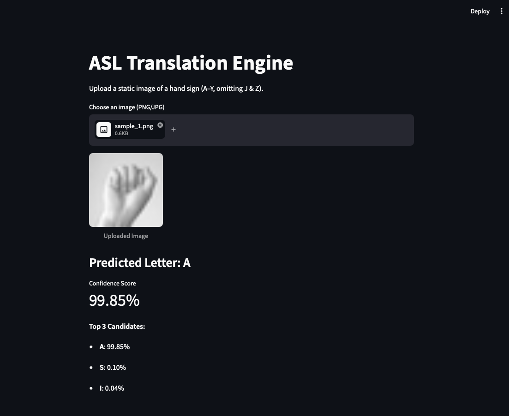

# ASL Sign Language Translation

This project builds a translation engine that recognizes an American Sign Language
hand sign from a static image and predicts the corresponding letter.

The project includes two model approaches:

1. **SVM:** an RBF Support Vector Machine trained on flattened image pixels.
2. **CNN:** a convolutional neural network trained with PyTorch.

The Streamlit app uses the CNN model for deployment. It accepts a PNG or JPG
image and displays the predicted letter, confidence score, and top three
candidate predictions.

## Dataset

The project uses the [Sign Language MNIST dataset](https://www.kaggle.com/datasets/datamunge/sign-language-mnist).

The dataset contains 28x28 grayscale images and separate training and test CSV
files:

- `sign_mnist_train.csv`
- `sign_mnist_test.csv`

The dataset's labels represent the static ASL alphabet classes. `J` and `Z` are
not included because they require motion.

## Sample Sign Images

To make testing easier, the repository includes a dedicated folder of sample
images for quick validation and demonstration:

```text
image_samples/
├── sample_1.png
├── sample_2.png
├── sample_3.png
├── sample_4.png
├── sample_5.png
└── ...
```

A visual sign reference panel is also included so viewers can quickly understand
how the model is interpreting different ASL hand shapes:



## Application Screenshot

The screenshot below shows the Streamlit app recognizing a sample hand sign and
displaying the predicted letter, confidence score, and top three candidates:



## Project Structure

```text
.
├── app.py                     # Streamlit application
├── amer_sign_panel.png        # ASL sign reference panel
├── screenshot.png             # Streamlit application screenshot
├── image_samples/             # Sample images for model testing
│   ├── sample_1.png
│   ├── sample_2.png
│   ├── sample_3.png
│   ├── sample_4.png
│   ├── sample_5.png
│   ├── sample_6.png
│   └── ...
├── Models/
│   ├── asl_svm_model.pkl      # Exported SVM model
│   └── asl_cnn_best.pth       # Exported CNN weights
├── Notebooks/
│   ├── NeuralNetwork.ipynb    # CNN training notebook
│   └── projectSVM.ipynb       # SVM notebook
├── README.md                  # Project documentation
└── ...
```

## If you want to run the app

Install the required Python packages:

```bash
pip install streamlit torch numpy pillow
```

Start the Streamlit application from the project root:

```bash
streamlit run app.py
```

Upload a grayscale or color image of a static ASL hand sign. The app converts
the image to grayscale, resizes it to 28x28 pixels, and normalizes the pixel
values before passing it to the CNN. You can also test the app with sample images
from the `image_samples/` directory.
